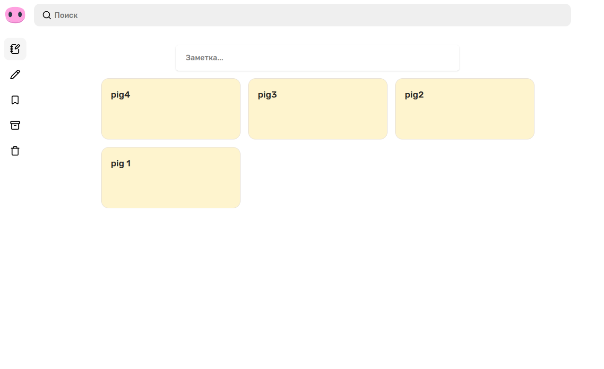
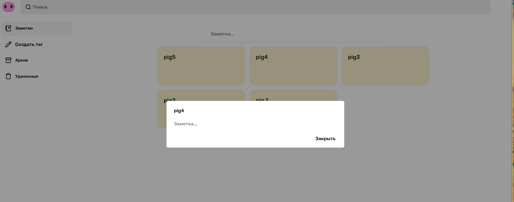
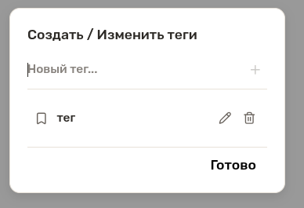
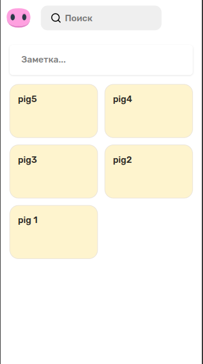

# 🐷 Pig Keep

Pig Keep - self-hosted веб-приложение для ведения заметок.

## Основной функционал:
  Создание, редактирование, архивация и удаление заметок с
  их организацией с помощью тегов.\
  Помимо этого в приложение встроен быстрый полнотекстовый поиск на базе PostgreSQL с поддержкой русской локализации по содержимому.

## Документация

- Особенности реализации: [docs/SPECS.md](https://github.com/Niki96434/google-keep/blob/main/docs/DETAILS.md)
- Документация по бэкенду: [backend/README.md](https://github.com/Niki96434/google-keep/blob/main/backend/README.md)
- Тестирование: [docs/TESTING.md](https://github.com/Niki96434/google-keep/blob/main/docs/TESTING.md)

## Из чего собрано

- React 19, Typescript, Vite, Eslint, Prettier, Vitest, RTL, MSW, RTQuery, Zod, Zustand
- Express.js, Supertest, Drizzle ORM
- PostgreSQL 18
- Docker

## Структура

- frontend/src - React-приложение
- backend/core - Инициализация базы данных, глобальный обработчик ошибок, мидлвары
- backend/features - feature-based модульная архитектура
- backend/migrations - миграции PostgreSQL
- docs - особенности решения, тестирование, скриншоты дизайна мобильного и десктоп интерфейсов

## Старт

Для запуска убедитесь, что у вас установлен Docker и плагин `docker compose`.

1. Подготовьте .env:
   ```bash
   cp .env.example .env
   ```
2. Собрать и поднять все в фоне:
   ```bash
   docker compose up -d --build
   ```
   
Апка будет доступна на `http://localhost:3000`

### Скриншоты

#### Главный экран (свернутое меню)


#### Создание и редактирование заметки


#### Создание и редактирование тегов


#### Мобильный интерфейс


